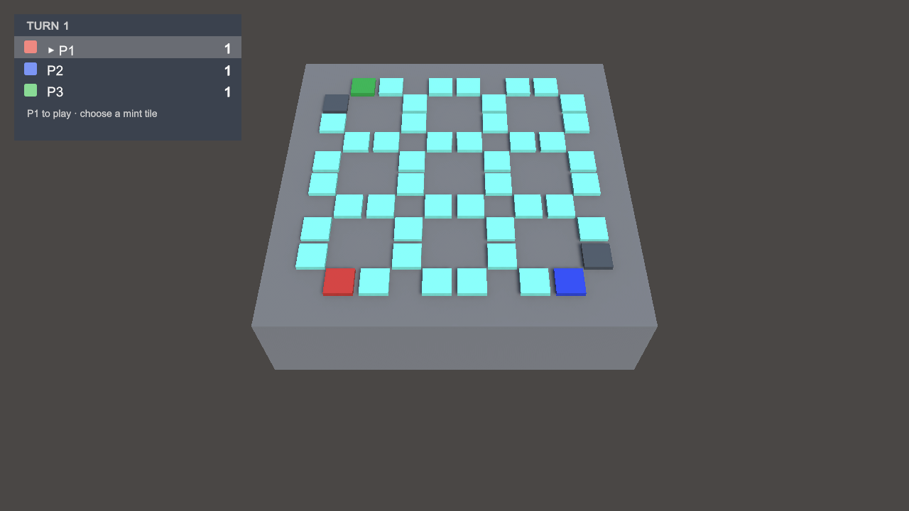

# WhoWhoo3D

A local strategy game for two to four people sharing one screen. Claim a mint tile on an open cube face. Filling the face sends its tiles across the adjoining edges and can start a chain reaction. The last player holding tiles wins.

[Watch a complete match](docs/reports/demo4x4.mp4) · [Browse the current status and six gameplay checkpoints](docs/reports/README.md)

## Play in Unity

Open the project in Unity **6000.4.5f1** and play `Assets/_Project/Scenes/Demo4x4.unity`. Choose a map and player count, then select **Start match**. Mint tiles accept a claim, a gold outline identifies the hovered legal tile, and gray tiles are locked by another player. Press **F3** to show the debug timeline. After victory, **Play again** restores the selected map and roster.

## Project status

| Area | Current state |
| --- | --- |
| Local match | Map and player setup, click-to-claim, animated waves, scores, elimination, result and restart |
| Verification | Unity Edit Mode rule tests and a Play Mode match driven by mouse events |
| Map editor | Separate authoring demo with place, erase, paint, save and load |
| Next playtest | Ask new players to identify a legal move, explain a wave, and start a second match. Check camera access on multi-sided maps. |

The capture command and its requirements are in the [gameplay report](docs/reports/README.md). Board formats and expansion rules are in the [map schema](docs/MAP_SCHEMA.md) and [wave specification](docs/WAVE_SPEC.md).
