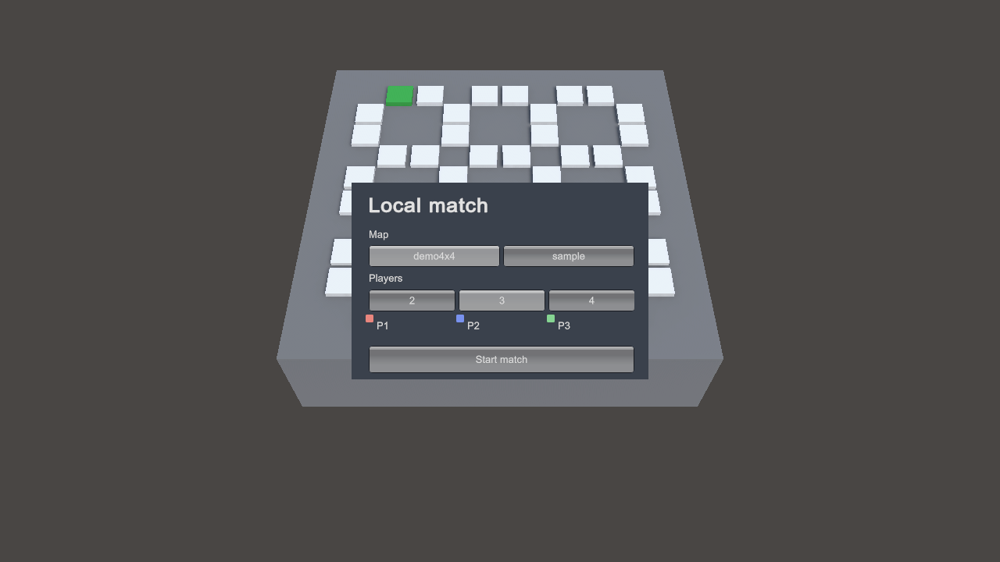
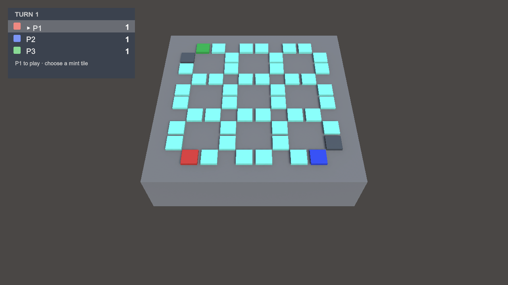
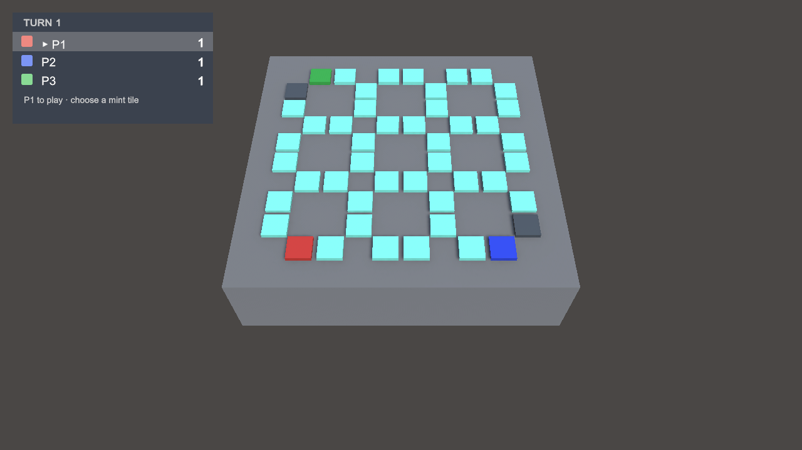

# WhoWhoo3D gameplay report

[Watch the full match and restart (43.5 s)](demo4x4.mp4)

Unity 6000.4.5f1 · Demo4x4 · three local players · **P1 won in 25 clicks**.

**Tests passed** — Edit Mode (100), Play Mode (1). The match check compares every displayed legal move with the board rules, exercises map and player selection, and checks the opening state after restart.

The silent video records the game window at 12 fps. A seeded driver sends mouse events through the scene camera and tile colliders. Setup and restart use the same controller actions as the HUD buttons. Wave playback is accelerated for review. This run covers the local game on macOS. Human playtesting and other platforms are still open.

## Local match setup

0.0 s



## Opening board and legal moves

1.2 s



## First claim and turn handoff

2.5 s


## Expansion across neighboring faces

11.8 s


## Match result

40.7 s


## Opening board after Play again

42.2 s



## Refresh

On a graphics-capable macOS desktop with the pinned Unity editor, Mac build support, Python 3, FFmpeg and ffprobe installed, run the following from the repo root.

```sh
python3 scripts/report.py
```

Use `--unity /path/to/Unity` to select the editor executable. The command tests a disposable project copy, builds a player, then replaces the report, screenshots and MP4 after the match and video checks pass. Raw frames and build products are temporary.
