# WhoWhoo3D gameplay report

[Watch the flat match and vertical demo (61.2 s)](demo4x4.mp4)

Unity 6000.4.5f1 · Demo4x4 · three local players · **P1 won in 25 clicks**.

**Tests passed** — Edit Mode (126), Play Mode (8). The match check compares every displayed legal move with the board rules, exercises map and player selection, checks restart, climbs a riser and clicks a rear face after orbiting.

The silent video records the game window at 12 fps. A seeded driver sends mouse events through the scene camera and tile colliders for the flat match. The terrace sequence stages a climb with legal alternating claims, rotates the camera by dragging, clicks the far wall, uses Relay and Freeze, takes supply and resolves a Beacon. The driver clicks Start match and Play again. The terrace sequence confirms Relay through the controller. Wave playback is accelerated for review. This run covers the local game on macOS. The LAN run below uses two copies of the same player.

## Local match setup

0.0 s


## Opening board and legal moves

1.6 s


## First claim and turn handoff

2.8 s

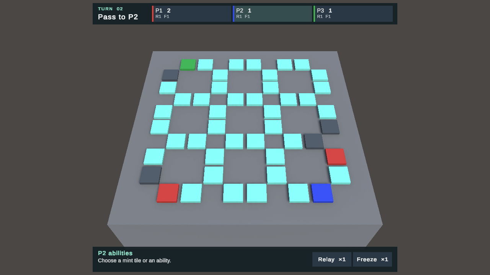

## Expansion across neighboring faces

12.1 s

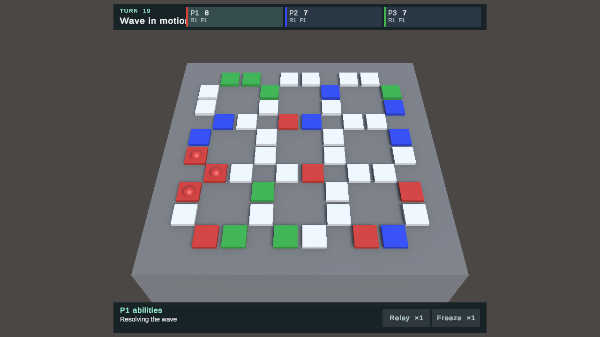

## Match result

41.0 s

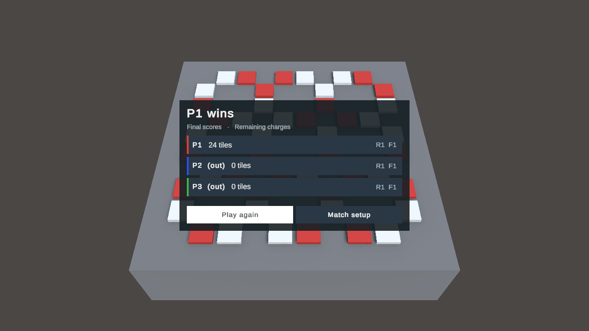

## Opening board after Play again

42.8 s


## Terrace 6×6 opening

44.2 s

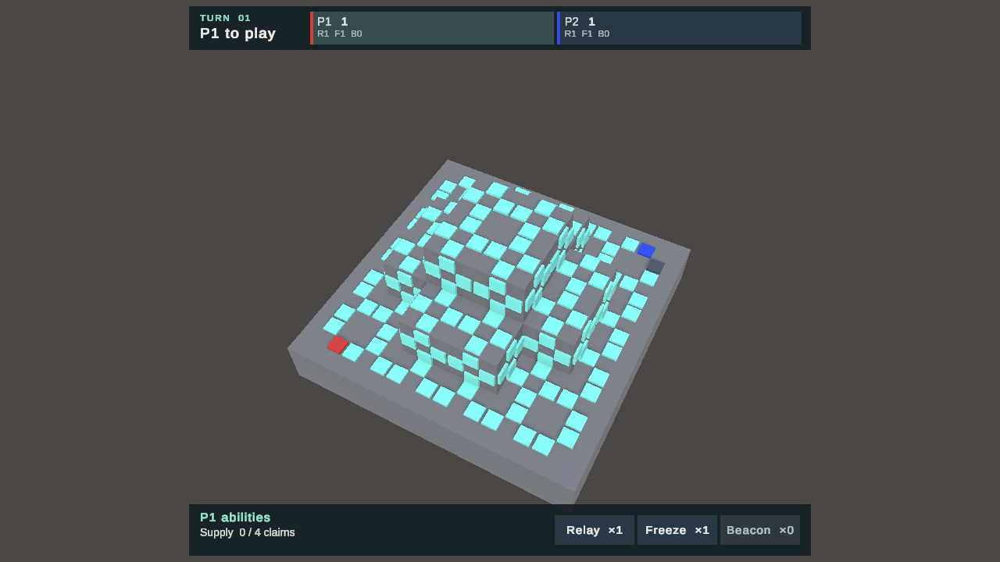

## Expansion from tread to riser

45.7 s

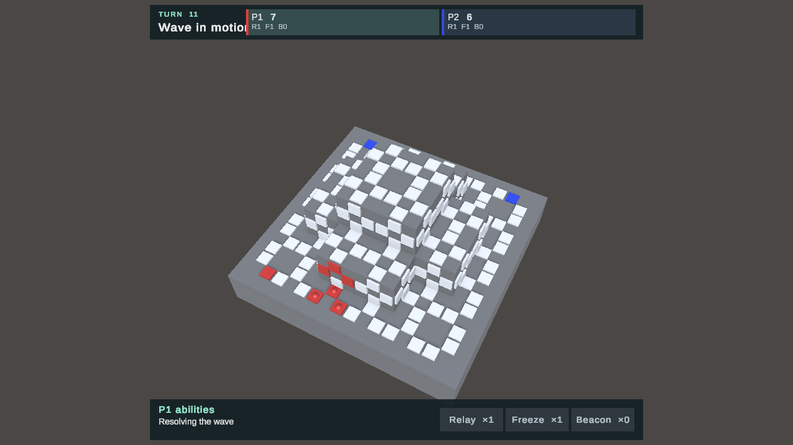

## The terrace after orbiting to the far side

50.2 s

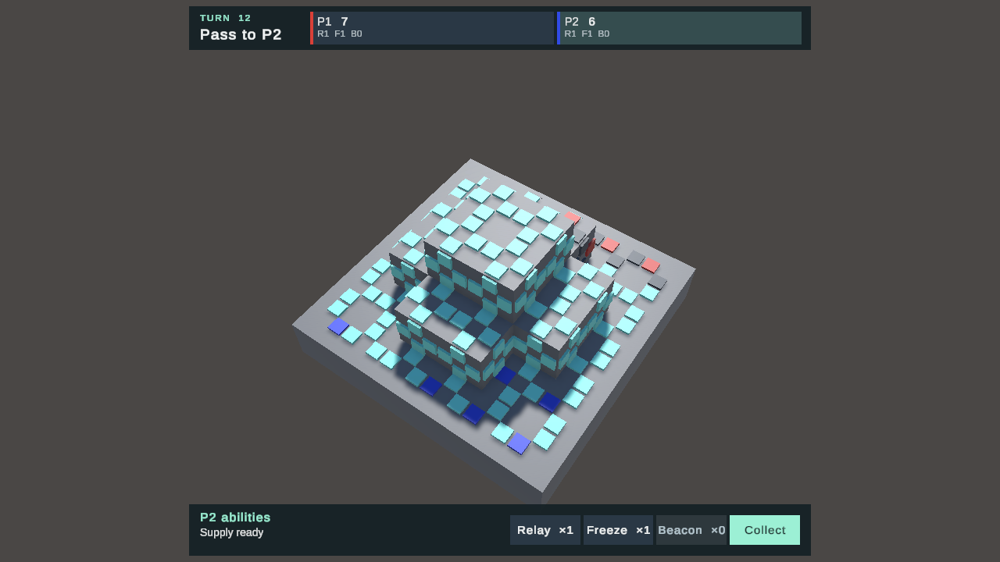

## Relay target preview before confirmation

51.8 s

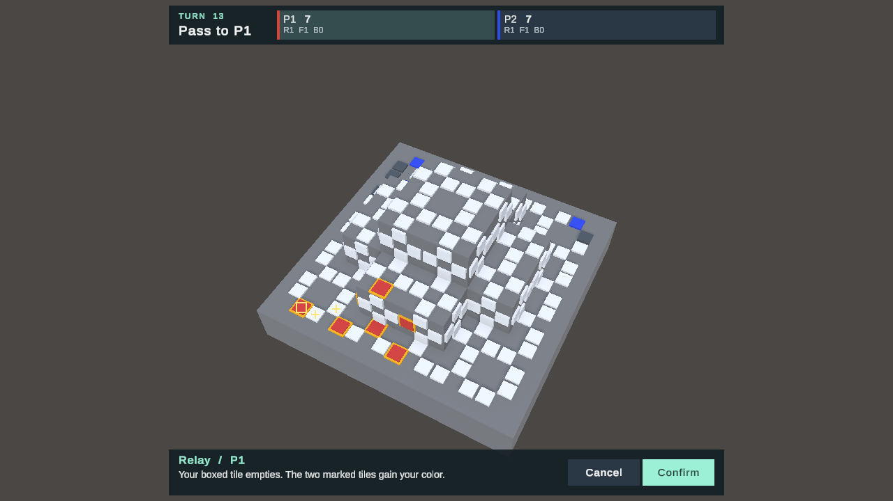

## A free supply choice after four ordinary claims

55.3 s

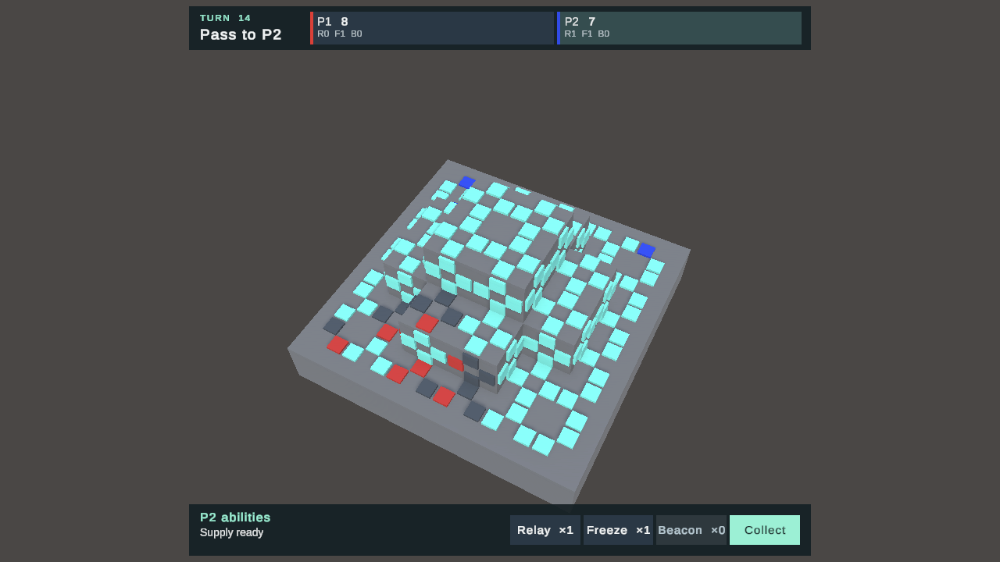

## Frozen cube during the opposing turn

56.5 s

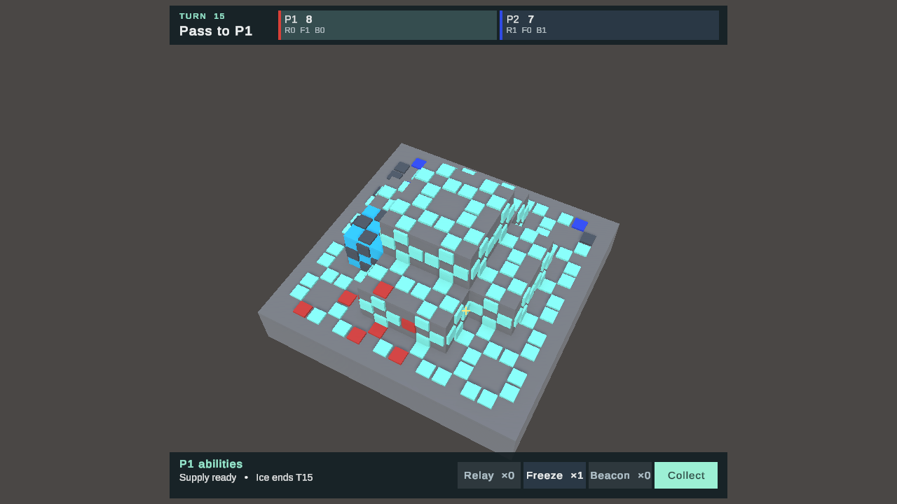

## Public Beacon marks before the opponent replies

57.8 s

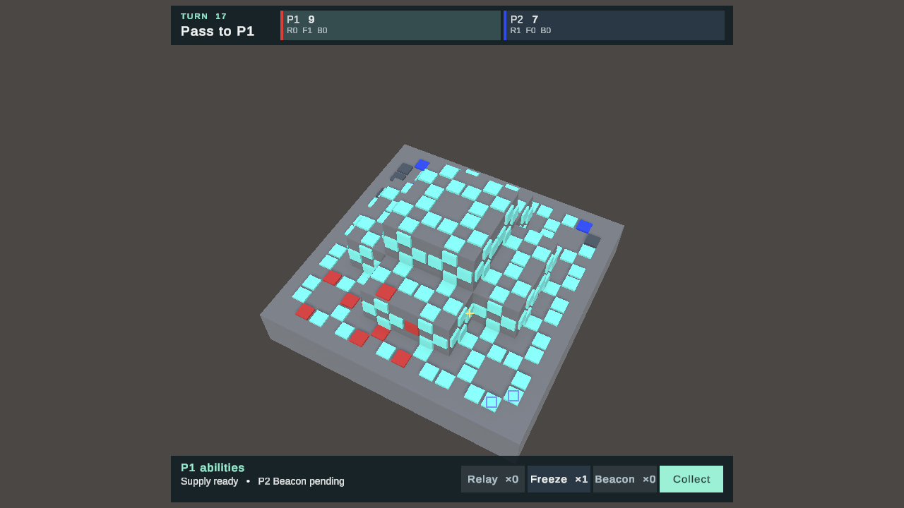

## Beacon starting a wave before its owner acts

59.2 s

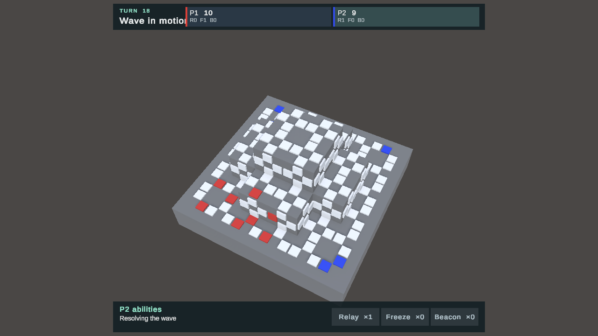

## Match setup and four-seat Freeze targeting at 800×480

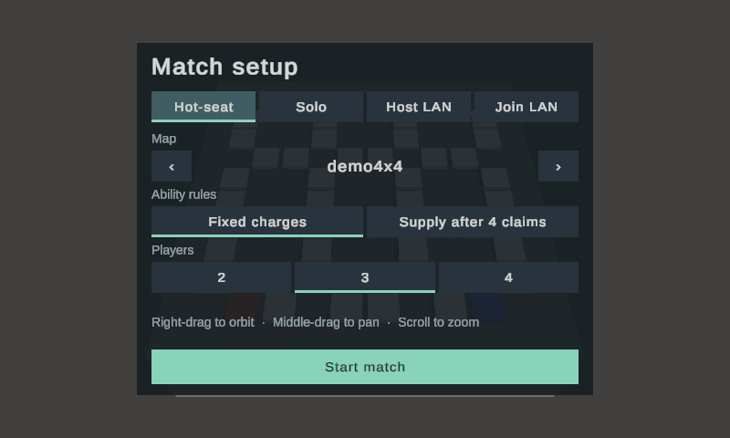

Real pointer input selected Freeze, picked a cube and orbited the camera with the preview still active. The capture driver exercised Cancel, Escape and Confirm and checked that only Confirm spent a turn.

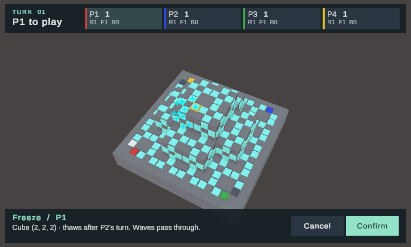

## LAN match

Two macOS player processes ran on one computer. The guest discovered the named room over UDP and joined its advertised TCP port. The host played P1 and the guest played P2. Both finished on turn 23 with the same board, roster and result (P1 won).

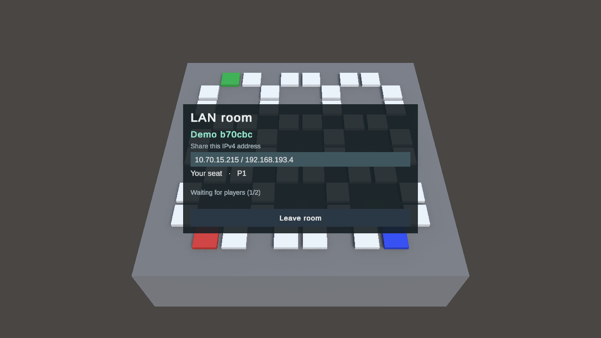

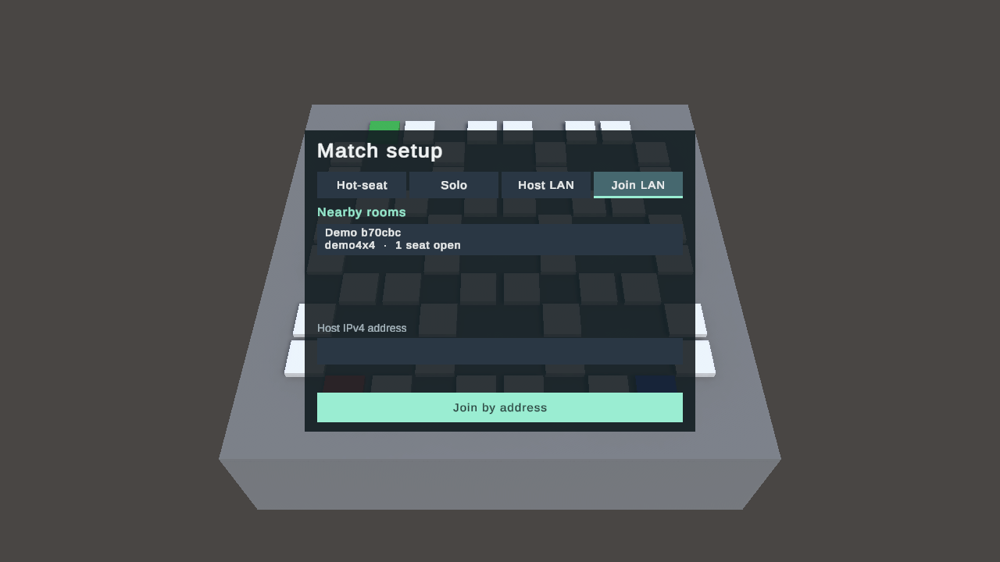

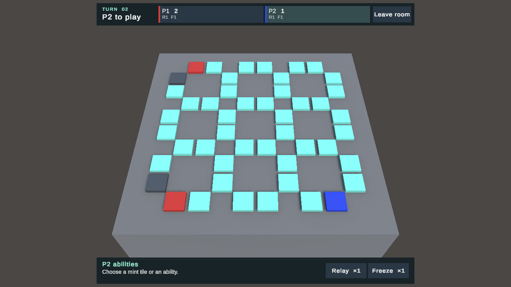


[Separate-interface and blocked-discovery checks](LAN.md)

## Refresh

On a graphics-capable macOS desktop with the pinned Unity editor, Mac build support, Python 3, FFmpeg and ffprobe installed, run the following from the repo root.

```sh
python3 scripts/report.py
```

Use `--unity /path/to/Unity` to select the editor executable. The command tests a disposable project copy, builds a player, then replaces the report, screenshots and MP4 after the match and video checks pass. Raw frames and build products are temporary.
