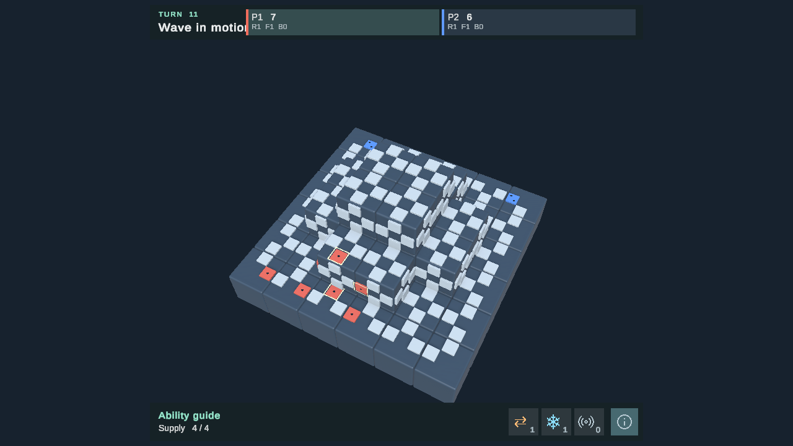
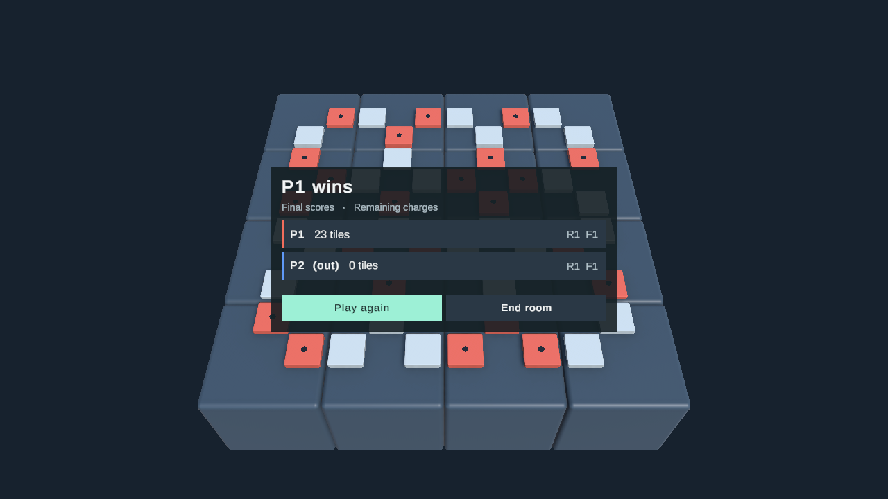

# Gameplay verification

Unity 6000.4.5f1 on macOS. 126 Edit Mode and 8 Play Mode tests passed. P1 won the three-seat 4×4 game in 25 pointer claims.

[Watch the complete match and terrace demo (64.2 s)](demo4x4.mp4) · [Watch the terrace wave](terrace-wave.mp4)

| Capture | Time |
| --- | --- |
| [Local match setup](screens/setup.png) | 0.0 s |
| [Opening board and legal moves](screens/opening.png) | 1.6 s |
| [First claim and turn handoff](screens/claim.png) | 2.8 s |
| [Expansion across neighboring faces](screens/wave.png) | 12.1 s |
| [Match result](screens/victory.png) | 41.0 s |
| [Opening board after Play again](screens/restart.png) | 42.8 s |
| [Terrace 6×6 opening](screens/terrace.png) | 44.2 s |
| [Inventory charges and ability guide](screens/inventory-guide.png) | 45.7 s |
| [Tread one claim from expanding](screens/one-away.png) | 47.5 s |
| [Expansion from tread to riser](screens/terrace-wave.png) | 48.7 s |
| [Wave landing on the upper terrace](screens/wave-landing.png) | 51.4 s |
| [The terrace after orbiting to the far side](screens/terrace-orbit.png) | 53.2 s |
| [Relay target preview before confirmation](screens/relay.png) | 54.8 s |
| [A free supply choice after four ordinary claims](screens/supply.png) | 58.3 s |
| [Frozen cube during the opposing turn](screens/freeze.png) | 59.5 s |
| [Public Beacon marks before the opponent replies](screens/beacon.png) | 60.8 s |
| [Beacon starting a wave before its owner acts](screens/beacon-wave.png) | 62.2 s |

## Terrace playback timing

One two-seat terrace match used seed 42 and ordinary claims. The longest chain in 119 actions started on turn 111 with 8 steps and 229 slot changes. The visible player replayed that action from its saved position in both modes and matched the reference snapshot.

Wall-clock frame intervals on Apple M3 at 1280×720, including presentation and frame pacing. The run used the scene’s normal wave duration with screen recording disabled.

| Motion | Frames | Median | 95th percentile | Maximum |
| --- | ---: | ---: | ---: | ---: |
| Normal | 3747 | 4.1 ms | 6.5 ms | 20.7 ms |
| Reduced | 589 | 6.1 ms | 6.7 ms | 13.0 ms |

## Inventory and adaptive layouts

The 800×480 window check drives Freeze selection, orbit, guide focus, Cancel and Confirm with real input. [Setup](screens/compact-setup.png) · [Freeze preview](screens/compact-freeze.png)

The offscreen layout checks use staged four-seat states. Each capture checks text overflow, overlap and bounds. Portrait uses simulated safe insets. Large text requests 2× and fits to the available space.

| Viewport | UI scale | Setup | LAN room | Target | Inventory | Result |
| --- | --- | --- | --- | --- | --- | --- |
| 800x480 | 1× | [setup](screens/layouts/800x480-1x-setup.png) | [room](screens/layouts/800x480-1x-room.png) | [target](screens/layouts/800x480-1x-target.png) | [guide](screens/layouts/800x480-1x-guide.png) | [result](screens/layouts/800x480-1x-result.png) |
| 800x480 | 2× | [setup](screens/layouts/800x480-2x-setup.png) | [room](screens/layouts/800x480-2x-room.png) | [target](screens/layouts/800x480-2x-target.png) | [guide](screens/layouts/800x480-2x-guide.png) | [result](screens/layouts/800x480-2x-result.png) |
| 1280x720 | 1× | [setup](screens/layouts/1280x720-1x-setup.png) | [room](screens/layouts/1280x720-1x-room.png) | [target](screens/layouts/1280x720-1x-target.png) | [guide](screens/layouts/1280x720-1x-guide.png) | [result](screens/layouts/1280x720-1x-result.png) |
| 1280x720 | 2× | [setup](screens/layouts/1280x720-2x-setup.png) | [room](screens/layouts/1280x720-2x-room.png) | [target](screens/layouts/1280x720-2x-target.png) | [guide](screens/layouts/1280x720-2x-guide.png) | [result](screens/layouts/1280x720-2x-result.png) |
| 1920x1080 | 1× | [setup](screens/layouts/1920x1080-1x-setup.png) | [room](screens/layouts/1920x1080-1x-room.png) | [target](screens/layouts/1920x1080-1x-target.png) | [guide](screens/layouts/1920x1080-1x-guide.png) | [result](screens/layouts/1920x1080-1x-result.png) |
| 1920x1080 | 2× | [setup](screens/layouts/1920x1080-2x-setup.png) | [room](screens/layouts/1920x1080-2x-room.png) | [target](screens/layouts/1920x1080-2x-target.png) | [guide](screens/layouts/1920x1080-2x-guide.png) | [result](screens/layouts/1920x1080-2x-result.png) |
| 3440x1440 | 1× | [setup](screens/layouts/3440x1440-1x-setup.png) | [room](screens/layouts/3440x1440-1x-room.png) | [target](screens/layouts/3440x1440-1x-target.png) | [guide](screens/layouts/3440x1440-1x-guide.png) | [result](screens/layouts/3440x1440-1x-result.png) |
| 3440x1440 | 2× | [setup](screens/layouts/3440x1440-2x-setup.png) | [room](screens/layouts/3440x1440-2x-room.png) | [target](screens/layouts/3440x1440-2x-target.png) | [guide](screens/layouts/3440x1440-2x-guide.png) | [result](screens/layouts/3440x1440-2x-result.png) |
| 360x640 | 1× | [setup](screens/layouts/360x640-1x-setup.png) | [room](screens/layouts/360x640-1x-room.png) | [target](screens/layouts/360x640-1x-target.png) | [guide](screens/layouts/360x640-1x-guide.png) | [result](screens/layouts/360x640-1x-result.png) |
| 360x640 | 2× | [setup](screens/layouts/360x640-2x-setup.png) | [room](screens/layouts/360x640-2x-room.png) | [target](screens/layouts/360x640-2x-target.png) | [guide](screens/layouts/360x640-2x-guide.png) | [result](screens/layouts/360x640-2x-result.png) |

## LAN match

Two macOS player processes ran on one computer. The guest discovered the named room over UDP and joined its advertised TCP port. The host played P1 and the guest played P2. Both finished on turn 23 with the same board, roster and result (P1 won).

[Separate-interface and blocked-discovery checks](LAN.md)

Regenerate the tests, captures and timing sample with the [build guide](../BUILD_GUIDE.md).
